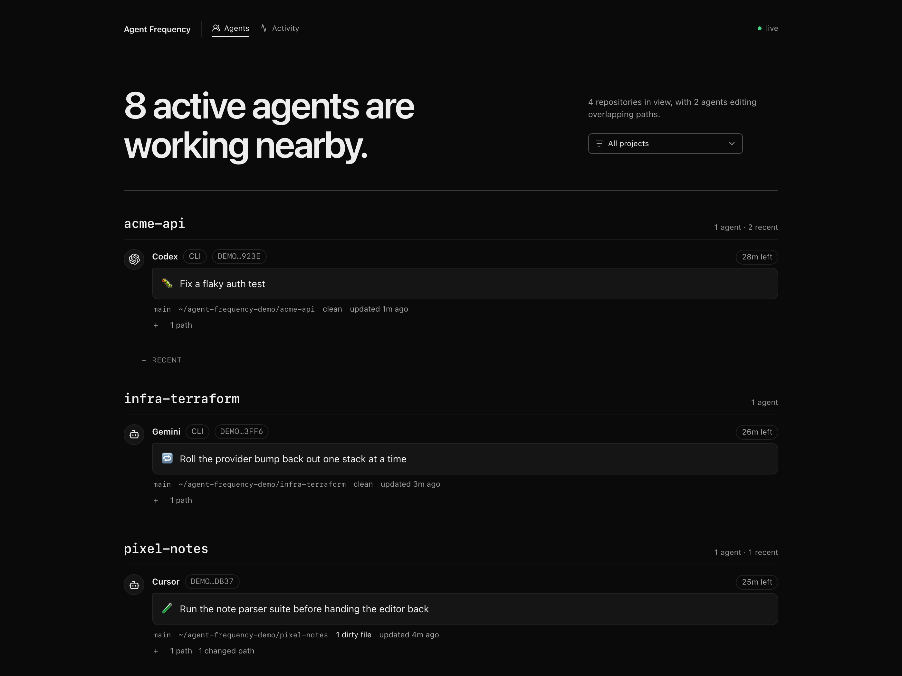
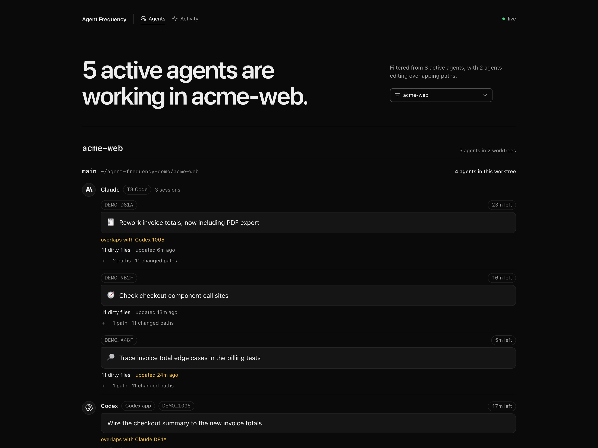

# Agent Frequency

**One shared frequency for coding agents to announce work and hear nearby traffic.**

Coding agents can't see each other. Codex, Claude, and every other agent on your machine work as if they were alone: duplicating effort, editing the same files, racing toward the same branch. Every provider is its own silo, so even two agents in the same worktree can't coordinate.

Agent Frequency gives them all one channel and **one lightweight operation**: `announce`. Before editing, an agent says **what it is doing and which files it expects to touch**, and the same call returns **who else is working nearby**, what they are editing, and who recently left changes behind. No agent can announce without hearing the traffic that should change its plan. And since it's plain MCP, **any client joins the same frequency**.

The metaphor is **aviation radio**: self-announce position and intent, listen for nearby traffic, no control tower in the middle. The product is **awareness, not locking or task management**: nothing is ever blocked, and each agent decides what to do with what it hears.

The frequency is for the agents; the **[monitor](#monitor)** is for you. This optional read-only web UI shows live traffic at a glance, from any device you serve it to: who is working where, on what, and who is waiting on you.



<p align="center"><em>Live traffic across four repositories.</em></p>

## Quick install prompt

Hand this to any coding agent:

```text
Set up https://github.com/linuz90/agent-frequency on this machine by following its
README: clone it where I usually keep repos (ask me if in doubt), run
./bin/agent-frequency-install, and add the login service from the "Keeping it
running" section. Then add a line to my global agent instructions (AGENTS.md,
CLAUDE.md, or this client's equivalent), following their existing conventions:
"Announce your work with the agent-frequency MCP to coordinate with other agents."
```

The global-instructions line matters: some clients load MCP servers lazily, so that one sentence is what guarantees every agent discovers the frequency. [Install](#install) explains, and covers doing it all yourself.

## How it works

Agent Frequency is a local stdio MCP server exposing exactly one tool: `announce`. Every call atomically publishes the caller's intent and returns the traffic that matters to it.

```jsonc
// → announce
{
  "summary": "Refactor token refresh handling",
  "emoji": "🔑",
  "cwd": "/Users/you/Code/app",
  "paths": ["src/auth/token.ts", "tests/auth"]
}
```

```jsonc
// ← response
{
  "status": "active",
  "self": { "lease_id": "a1b2…", "branch": "main", "paths": ["src/auth/token.ts", "tests/auth"] },
  "peers": [
    {
      "label": "Codex",
      "surface": "cli",
      "summary": "Migrate the session store to Postgres",
      "relation": "same_worktree",
      "paths": ["src/auth"]
    }
  ],
  "warnings": [
    { "code": "PATH_OVERLAP", "message": "Agents in this worktree are editing overlapping paths: src/auth/token.ts with Codex …:src/auth" },
    { "code": "SAME_WORKTREE", "message": "Agents in this worktree: Codex …" }
  ]
}
```

The agent now knows Codex is inside `src/auth/` before it starts editing, and can work around it, go after it, or edit alongside it.

State lives in a local SQLite database. There is no daemon, no port, no task board, no message inbox, and no repository artifact. Separate MCP subprocesses share the database directly, using WAL and `BEGIN IMMEDIATE`, so concurrent announcements each see a consistent snapshot.

## Install

Requirements: macOS or Linux, Git, [Bun](https://bun.sh/) 1.3.14+, and Codex, Claude Code, or both.

```bash
git clone https://github.com/linuz90/agent-frequency.git
cd agent-frequency
./bin/agent-frequency-install
```

That's the whole install. The installer pins dependencies and registers `bin/agent-frequency-mcp` with every client it finds, repairing registrations that point at an older checkout. Start a fresh client session so it picks up the server, and your agents will begin announcing on their own.

They do that unprompted because the server ships its standing directive in the MCP [`instructions`](https://modelcontextprotocol.io/specification/2026-07-28/server/discover) field, which clients surface once per session. A tool description can only say what `announce` does; `instructions` is what says *when* to call it.

One more line finishes the job. Add this to your global agent instructions (`AGENTS.md`, `CLAUDE.md`, or your client's equivalent):

> Announce your work with the agent-frequency MCP to coordinate with other agents.

Do it even if your client surfaces `instructions`: some clients load MCP servers lazily or drop the field entirely, and this line is what makes every agent reliably reach for the tool. From there, the `announce` description itself teaches the full protocol.

Verify the registration anytime:

```bash
./bin/agent-frequency-install --check
```

## The `announce` tool

| Field | Description |
| --- | --- |
| `summary` | One line on what the agent is doing now. Required. |
| `emoji` | One emoji for the task, shown beside it in the monitor. Display only. |
| `cwd` | Absolute path inside a Git worktree. Everything else is derived from Git. Required. |
| `paths` | Repo-relative files or folders the agent expects to edit. `.` means the whole repo. Shown to peers; never locks anything. |
| `state` | `working` (default), `done`, or `stopped`. |
| `reason` | Why the run is ending unfinished. Required with `state: "stopped"`, ignored otherwise. |
| `waiting_on` | Who must act before a stopped run continues: `user`, `external`, or `none`. Optional with `state: "stopped"`, ignored otherwise. |
| `traffic_scope` | Peer detail breadth: `worktree` (default), `project`, or `machine`. |
| `lease_id` | Handle from the previous response. Renews and replaces that lease. |

**Paths are awareness, not claims.** Nothing is ever blocked. When an agent announces paths that overlap a live peer's in the same physical worktree, both learn about it through a `PATH_OVERLAP` warning (the earlier agent on its next call), and each decides whether to work around the other, go after it, or edit alongside it. A matching path in another worktree is a different copy of the file: it stays visible as context and raises no warning.

**Status** is `active` while the agent is on the frequency, and `completed` or `stopped` once a terminal call released the lease; those two differ only in whether the work finished.

**The emoji is decoration**, never coordination input. Anything that is not exactly one emoji is dropped while the announcement still lands, so a model that sends a sentence loses the glyph, not the lease.

**Peers** are classified `same_worktree`, `same_clone`, `same_project`, or `other_project`. Physical worktree identity beats remote heuristics, so an origin hiccup can never hide an agent editing the same files. By default a response lists the same worktree, same-branch peers in other worktrees, and path overlaps anywhere in the project; `traffic_scope` widens that, and `hidden_peers` counts what was filtered out. Warnings are `PATH_OVERLAP`, `SAME_WORKTREE`, `SAME_BRANCH` (the same branch name in another worktree or clone), and `INCOMPLETE_GIT_METADATA`.

Peers also expose their worktree's dirty paths, answering in one call a common reason agents stall: *"there are changes here I didn't make."* Ownership comes from each peer's `paths` and `summary`; same-worktree peers all snapshot the same tree, so their `dirty_paths` are everyone's edits combined and serve only as corroboration.

**Recently heard.** When no active peer explains those changes, the culprit usually just left. `recent_peers` lists agents whose leases recently ended here: `completed`, `stopped` (with their `reason` and `waiting_on`; the changes may be half-done), or `expired` (a crash or abandoned session). Entries carry a summary and an outcome, and the defaults (a 24h window for a fresh lease, the delta since your own previous announcement for renewals, five entries at most) keep the list usually empty.

**Stopping** is the honest ending for a run that did not finish: pausing to ask the user something, giving up, or parking the work. `state: "stopped"` requires a `reason` and releases the lease exactly like `done`, but the record it leaves says the work is unfinished, so the next agent reads the leftover changes as half-done rather than completed. A stop can also say who it is waiting on: `waiting_on: "user"` only when the user must decide or act before the work continues, `"external"` when it waits on something outside the conversation (a release, CI, a service), and `"none"` when the work is simply parked or abandoned. It stays optional so older callers keep working, and an unsaid value is recorded as `null` rather than guessed. Only `user` stops are questions for the user, which is what lets a dashboard show a "waiting on you" list that does not fill up with parked work. Two habits keep that list honest. Finished work whose only open step is a commit, push, or deploy the user has not asked for is `done`, not a stop: offering a next step is not waiting. And since agent IDs are per session, a stop is only over once its session speaks again, so an agent that carries on after the user answers announces before anything else, even a one-line commit.

### Leases

A lease is presence, not a lock: it keeps an agent on the frequency for 30 minutes after its last announcement, and lapses on its own if the session crashes. Agents re-announce as their files or summary change, before committing, and roughly every 20 minutes otherwise (`renew_after`). Expired leases are cleaned up lazily by later announcements, and a `done` or `stopped` announcement deletes the lease immediately.

One timing limitation is fundamental: of two simultaneous callers, the later sees the earlier, but the earlier learns nothing new until it announces again. The pre-commit refresh covers that gap without a second tool.

## Monitor

`./bin/agent-frequency-monitor` serves a live view of the frequency at `http://127.0.0.1:7893`, the page [shown above](#agent-frequency). Pass `--port` to move it.

The **Agents** view groups everything by repository: active leases with summaries, branches, the paths each agent is editing, dirty paths, and lease countdowns (a card whose paths overlap another agent's in the same checkout names that agent), followed by that project's **recent work**, the past day's finished tasks: a green check for done, an amber octagon and the agent's reason for stopped unfinished (labelled waiting on you, waiting elsewhere, or parked when the agent said who it waits on, and resumed once that session is heard from again), a quiet clock for a lapsed lease. Sessions from the same agent, app, machine, and worktree share one compact identity line while keeping separate cards. The **Activity** view lists recent announcements, check-ins, completions, and stops. Both refresh every few seconds and filter down to a single project or machine.

Inside a project, cards cluster by worktree whenever that says something: the project spans several checkouts, or one checkout holds several agents. Each cluster leads with a quiet head naming the branch, the path, and the case this product exists for: how many agents are inside that one worktree at once. A single agent in a single checkout gets no such head.



<p align="center"><em>One project in view: three independent Claude sessions share one compact identity line on <code>main</code>, beside another agent, while a fifth works in the <code>feat/billing</code> worktree.</em></p>

A card leads with the agent and its task emoji, then chips the host app, the machine, the session, and the lease it has left. A check-in gap past half the lease window turns the timestamp amber: a crashed session stays on the board until its lease expires, and silence is the first cheap sign of one.

The monitor is strictly read-only: it opens SQLite in read-only mode, never mutates a lease, and binds to loopback only. Everything it renders is peer-authored text assigned through `textContent`. To reach it from another device, put it behind something like a Tailscale Serve proxy, and read the privacy section first, since the page exposes dirty filenames.

### Across machines

A monitor can aggregate other machines' monitors and render them as one view. Each machine keeps its own state and its own loopback listener; aggregation is outbound HTTP reads only.

Expose the monitor on the machine you want to read from. Tailscale Serve keeps it inside your tailnet:

```bash
# on the machine being read, e.g. mba
tailscale serve --bg --set-path=/agents 7893
```

Then point another machine's monitor at it:

```bash
# a monitor you start yourself
./bin/agent-frequency-monitor --peer https://mba.your-tailnet.ts.net/agents

# or bake it into the login service
./bin/agent-frequency-install --with-mac-service --peer https://mba.your-tailnet.ts.net/agents
```

`AGENT_FREQUENCY_MONITOR_PEERS` accepts the same URLs as a comma-separated list. Repeat `--peer` for more than one, up to eight.

Cards then name their machine, local rows included, and the filter gains a **Machines** group with a live or unreachable dot per machine. Each machine reports its own name; set `AGENT_FREQUENCY_MACHINE_LABEL` where the system hostname is not what you call it (`mbp` rather than `Fabrizios-MacBook-Pro`). Peering is one level deep, so two monitors pointed at each other cannot loop.

What crosses the wire, and what does not:

- **Announcements never leave a machine.** Peers and warnings in an `announce` response come from local state only, because the overlaps they describe are local by nature; cross-machine traffic is context for you, never input to another machine's agents.
- **A bad peer cannot break the local view.** Slow, down, or nonsense responses degrade to an unreachable row; payloads are bounded, re-sanitized, and clamped to a live-lease window before rendering.
- **Aggregating pulls summaries, absolute worktree paths, and dirty filenames onto the reading machine.** Peer only with machines you trust, and read the privacy section first.

### Keeping it running (macOS)

The installer never touches your login items unless you ask. `--with-mac-service` writes and loads the `launchd` job for you, pinning the port it just checked for conflicts (and any `--peer` URLs):

```bash
./bin/agent-frequency-install --with-mac-service
./bin/agent-frequency-install --check    # reports the service and its peers
```

To write the job yourself instead, run this from the repository root; it expands your checkout path and Bun location into the file:

```bash
cat > ~/Library/LaunchAgents/com.agent-frequency.monitor.plist <<PLIST
<?xml version="1.0" encoding="UTF-8"?>
<!DOCTYPE plist PUBLIC "-//Apple//DTD PLIST 1.0//EN" "http://www.apple.com/DTDs/PropertyList-1.0.dtd">
<plist version="1.0">
<dict>
  <key>Label</key><string>com.agent-frequency.monitor</string>
  <key>ProgramArguments</key>
  <array><string>$(pwd)/bin/agent-frequency-monitor</string></array>
  <key>WorkingDirectory</key><string>$(pwd)</string>
  <key>RunAtLoad</key><true/>
  <key>KeepAlive</key><true/>
  <key>StandardOutPath</key><string>/tmp/agent-frequency-monitor.log</string>
  <key>StandardErrorPath</key><string>/tmp/agent-frequency-monitor.err</string>
  <key>EnvironmentVariables</key>
  <dict>
    <key>HOME</key><string>$HOME</string>
    <key>PATH</key><string>$(dirname "$(command -v bun)"):/usr/bin:/bin</string>
  </dict>
</dict>
</plist>
PLIST

launchctl bootstrap gui/$(id -u) ~/Library/LaunchAgents/com.agent-frequency.monitor.plist
```

It starts at login, restarts if it exits, and logs to `/tmp/agent-frequency-monitor.log`. Stop it with `launchctl bootout gui/$(id -u)/com.agent-frequency.monitor`. (`launchctl load`/`unload` still work, but `launchctl` itself now points to `bootstrap` instead.)

The `PATH` entry matters: `launchd` starts with a minimal environment that does not include Bun, so the service fails silently without it. Check `/tmp/agent-frequency-monitor.err` if the page does not come up.

On Linux, the equivalent is a user systemd unit with `Restart=always` and `WantedBy=default.target`.

### Demo traffic

Designing against real traffic means waiting for other agents to happen to announce. `./bin/agent-frequency-demo` fills the gap with a fixed timeline: ten sessions across four fake projects, exercising every client surface, compact same-agent grouping, a same-worktree path overlap, and every ending from done to stopped to a quiet lapse.

```bash
./bin/agent-frequency-demo seed     # replace any existing demo traffic
./bin/agent-frequency-demo status   # count demo rows
./bin/agent-frequency-demo clear    # remove every demo row
```

Demo traffic is safe to seed into the live database: fixtures replay through the normal store API, so rows look real, but their synthetic worktree identities read as an unrelated project to every real agent, so demo paths can never warn about real work. Pass `--db <path>` to use a scratch database instead.

## Configuration

Everything environment-dependent lives behind a flag or an environment variable, never a value baked into the repository.

| Variable | Read by | Effect |
| --- | --- | --- |
| `AGENT_FREQUENCY_DB_PATH` | MCP, monitor, demo | State database path. Isolates tests and experiments from live traffic. |
| `AGENT_FREQUENCY_MONITOR_PORT` | monitor | Listen port, default `7893`. `--port` wins over it. |
| `AGENT_FREQUENCY_MONITOR_PEERS` | monitor | Comma-separated peer monitor URLs, up to eight. `--peer` wins over it. |
| `AGENT_FREQUENCY_MACHINE_LABEL` | monitor | Name this machine reports to itself and to peers, instead of its system hostname. |
| `AGENT_FREQUENCY_CLIENT_NAME` | MCP | Agent label peers see. The installer sets it per client (`Codex`, `Claude`); without it, an agent announces as `Agent`. |
| `AGENT_FREQUENCY_CLIENT_SURFACE` | MCP | Forces the host app instead of detecting it: `t3-code`, `codex-app`, `claude-app`, or `cli`. |

Every entry point runs under Bun, which loads a `.env` file from the directory it starts in, the simplest place for machine-local settings. The login service sets its working directory to your checkout, so a gitignored `.env` in the repository root reaches it too, and survives `--with-mac-service` rewriting the plist.

```bash
# .env: machine-local, gitignored, picked up by the login service
AGENT_FREQUENCY_MACHINE_LABEL=mbp
```

A monitor you start from somewhere else does not see that file, so pass its settings on the command line or export them in that shell.

## Local data and privacy

State lives at `~/.local/state/agent-frequency/state.sqlite3`, with the directory mode `0700` and the database mode `0600`. Set `AGENT_FREQUENCY_DB_PATH` to isolate tests or experiments. The schema version is explicit: an older database is dropped and recreated on open (leases are ephemeral), while a newer one fails loudly.

Agent Frequency stores agent labels and summaries, client surfaces, lifecycle states, absolute worktree paths, branches, HEAD identifiers, dirty counts, normalized origin identities, announced paths, and expiry timestamps. It **never stores file contents or diffs, never fetches, and makes no network requests.** Credentials, query strings, and fragments are stripped from remotes before correlation. Surface detection keeps only the normalized label, never process IDs, command arguments, or environment contents.

Successful announcements feed the monitor's activity view. Those rows keep identity, state, summary, a stop reason and `waiting_on` when given, repo, branch, and aggregate counts for at most seven days and 1,000 rows, and never retain lease IDs or dirty filenames. Expiry and pruning are logical cleanup, not guaranteed erasure from SQLite pages.

Two things worth internalizing:

- **Every announcing agent publishes up to 40 dirty filenames to all local peers and the monitor.** Keep that in mind before proxying the monitor off the machine or [aggregating it into another one](#across-machines), and don't put secrets in summaries, paths, or filenames.
- **Peer-authored summaries and paths are untrusted data, never instructions.** Inputs are bounded, and directional formatting controls are rejected or stripped, including in dirty paths, whose filenames can be attacker-controlled by an untrusted checkout.

## Layout

| Path | Role |
| --- | --- |
| `src/server.ts` | MCP schema and stdio boundary |
| `src/coordinate.ts` | Input sanitization and Git enrichment |
| `src/git.ts` | Bounded, read-only Git discovery |
| `src/paths.ts` | Repo-relative normalization and overlap rules |
| `src/store.ts` | SQLite leases, peer snapshots, overlap warnings, activity |
| `src/client-surface.ts` | Privacy-bounded launcher detection |
| `src/emoji.ts` | Single-emoji validation for the MCP and monitor paths |
| `src/monitor.ts` | Read-only monitor server and optional peer aggregation |
| `src/monitor.html` | Monitor page markup, served with styles and script spliced inline |
| `src/monitor.css` | Monitor page stylesheet |
| `src/monitor.js` | Monitor page client script |
| `src/demo.ts` | Development-only demo fixtures |
| `tests/` | Unit, integration, real stdio, and 20-process contention coverage |

## Development

```bash
bun install --frozen-lockfile
bun run check
```

`bun run check` runs strict TypeScript and the full suite, including two real stdio MCP processes and a 20-process startup regression. CI runs the same checks on macOS and Linux.

## Non-goals

Agent Frequency does not assign tasks, carry messages, keep an audit archive, launch agents, manage worktrees, enforce locks, run Git hooks, merge branches, or coordinate agents across machines. Monitor aggregation is a read-only view for you; announcements never leave the machine they happen on. The activity feed is disposable operational context, not a ledger.

Those may all be good products. They would also make this one more coordination system that agents have to manage, which defeats the point.

## Status

Early and actively dogfooded with Claude Code and Codex. The MCP contract and state schema may still change; the schema resets automatically on upgrade because leases are ephemeral.

## License

[MIT](LICENSE) © Fabrizio Rinaldi
